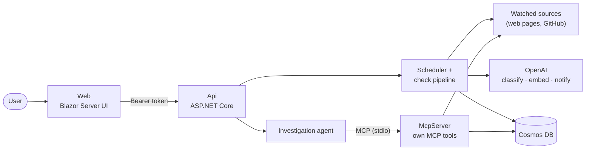

# Watch This for Me

**An AI agent that keeps watching things for you after you leave, and tells you only when something that matters to you changes.**

You describe what you care about in plain English:

> *"Watch the .NET GitHub repo for new releases and tell me if anything breaks ASP.NET Core."*

The app turns that into a persistent monitoring job. On a schedule, it fetches the source and works out what actually changed. An LLM decides whether the change is *meaningful by your criteria* or just noise, such as timestamps, reshuffled navigation or reworded copy. When the change matters, an agent can investigate further using its own tools and write you a short notification that cites the evidence it gathered.

> This isn't a chatbot that answers a question. It's a system that keeps working after you leave.

---

## Highlights

- **Meaningful-change classification, measured.** The classifier is scored against a hand-labeled ground-truth set of 97 examples across 8 domains (releases, pricing, security advisories, API docs, status pages, …). It scored **99.0% accuracy, 98.2% precision and 100% recall** after tuning, up from a 96.9% baseline. See [`eval/`](eval/).
- **A real tool-using agent, with its own MCP server.** The investigation agent runs a tool-calling loop against OpenAI. It connects as a client to the project's own [Model Context Protocol](https://modelcontextprotocol.io) server, which exposes web-page, observation-history and GitHub tools. The agent is limited to read-only tools and at most 5 tool calls per investigation.
- **Grounded notifications.** A notification may cite evidence only by referring to facts the investigation actually gathered (the diff and each tool result), so every citation points to real captured data rather than text the model wrote itself.
- **RAG for consistent judgment.** Each observation's summary is embedded. When a new change is classified, similar past observations are retrieved and passed to the model so it judges the new change consistently with past ones.
- **Built to run unattended.** It retries with timeouts on every outbound call and makes sure the same watch is never checked twice at once. It also tracks the outcome of every check and stops retrying a watch automatically after 3 consecutive failures.
- **Observable.** OpenTelemetry traces every check through fetch → diff → classify → embed → save, recording step timings, real OpenAI token counts and failure counts. Locally they print to the console; in Azure they go to Application Insights.
- **Secure by default.** Users sign in with Entra ID and the Api accepts tokens only, with every endpoint locked unless explicitly opened. Secrets live in Key Vault, and the app reaches Key Vault and Cosmos DB through its Managed Identity, so no keys exist to leak. Without sign-in configured, the app refuses to start anywhere except local development.

## Architecture



| Project | Role |
|---|---|
| `src/WatchThisForMe.Core` | Domain model (`Watch`, `Observation`, `Notification`, …) and interfaces. No dependencies. |
| `src/WatchThisForMe.Infrastructure` | Cosmos DB storage, source fetchers, normalization + diffing, OpenAI clients, the agent, telemetry, security wiring. |
| `src/WatchThisForMe.Api` | REST API plus the background scheduler that runs the check pipeline. |
| `src/WatchThisForMe.Web` | Blazor Server UI. |
| `src/WatchThisForMe.McpServer` | The project's own MCP server (stdio), exposing tools the agent can call. |
| `tests/WatchThisForMe.Tests` | Unit and integration tests (xUnit). |
| `eval/WatchThisForMe.Evaluation` | Scores the real classifier against the ground-truth dataset. |

## How a check works

1. **Fetch** the source.
2. **Normalize** it by stripping volatile content (timestamps, session tokens, etc.) so it doesn't create false changes.
3. **Diff** it against the previous observation.
4. **Classify** the diff with an LLM against the watch's own "meaningful change" criteria, with similar past observations retrieved via embeddings as context.
5. **Save** the observation and its embedding. Only the last 10 observations are kept per watch.
6. On request, **investigate** with the agent and produce a **grounded notification**.

## Tech stack

.NET 10 · ASP.NET Core · Blazor Server · Azure Cosmos DB · OpenAI (Responses API, `gpt-4o-mini`, `text-embedding-3-small`) · Model Context Protocol · OpenTelemetry / Application Insights · Microsoft Entra ID · Azure Key Vault · Managed Identity · xUnit · DiffPlex

## Running it locally

**Prerequisites**
- [.NET 10 SDK](https://dotnet.microsoft.com/download)
- [Azure Cosmos DB Emulator](https://learn.microsoft.com/azure/cosmos-db/emulator), running on `https://localhost:8081`
- An OpenAI API key

**1. Store your OpenAI key** with user-secrets, so it stays out of the repo:

```bash
dotnet user-secrets set "OpenAi:ApiKey" "<your-key>" --project src/WatchThisForMe.Api
```

Optionally, add a GitHub token. Without one, GitHub's limits on anonymous requests can kick in quickly:

```bash
dotnet user-secrets set "GitHub:Token" "<your-token>" --project src/WatchThisForMe.Api
```

**2. Run the Api and the Web UI** in two terminals:

```bash
dotnet run --project src/WatchThisForMe.Api --launch-profile http   # http://localhost:5003
dotnet run --project src/WatchThisForMe.Web --launch-profile http   # http://localhost:5218
```

Then open http://localhost:5218. The database and containers are created automatically in the emulator on first start.

In local development, with no Entra ID configured, sign-in is turned off and both apps log a warning saying so. In any other environment, missing sign-in settings stop the app from starting.

**Run the tests.** The Cosmos tests need the emulator running.

```bash
dotnet test
```

**Run the classifier evaluation.** This makes real OpenAI calls, one per example. It reuses the Api's user-secrets, so no extra setup is needed. Results are written to `eval/results.json`.

```bash
dotnet run --project eval/WatchThisForMe.Evaluation
```

## Further reading

- [`PROJECT-NOTES.md`](PROJECT-NOTES.md): plain-English explanations of every piece and why it's built the way it is
- [`DAILY-PLAN.md`](DAILY-PLAN.md): the day-by-day build log
- [`watch-this-for-me-project.md`](watch-this-for-me-project.md): the original project spec
